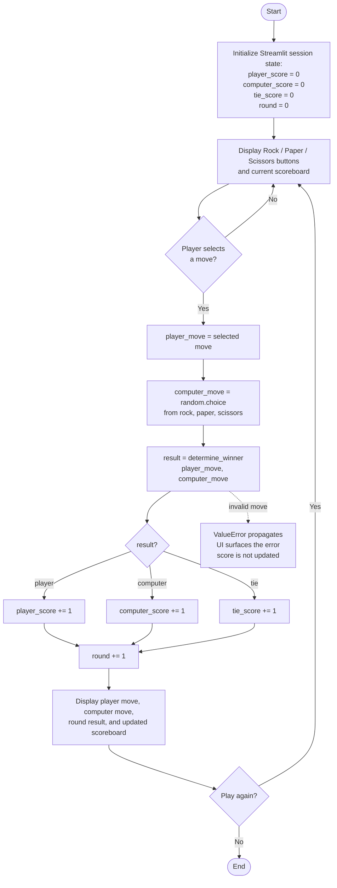

# Rock, Paper, Scissors - Development Conversation Transcript

**Project:** Rock, Paper, Scissors game  
**Stack:** Python 3.13, pytest, Streamlit 1.66  
**Methodology:** Design-First and Test-Driven Development (TDD)  
**Date:** 2026-11-05  
**Project directory:** `C:\Users\souta\Desktop\RPSgame`

**Session rules followed**

- No implementation code was written before the design was approved.
- Test files were never modified or deleted after creation.
- No tests were skipped with `@pytest.mark.skip`.
- No `try/except` blocks were used to hide errors.
- Work proceeded phase by phase, waiting for approval after each phase.

---

## Phase 1 — Design

### User

> Hi opencode, I need your help with a proyect.
>
> Role: You are an expert Python Developer. We are going to build a Rock, Paper, Scissors game using Python and Streamlit. We will use TDD and Design-First.
>
> Here are the strict rules for this session:
>
> - Do not write any implemention code until I approve the design.
> - Never modify or delete the test files once they are created.
> - Never use @pytest.mark.skip or wrap code in try/except to hide errors.
>
> We will proceed phase by phase. Wait for my approval after each phase.
>
> PHASE 1: DESIGN
>
> 1. Provide a Mermaid flowchart diagram (explain the game logic, including the scoreboard and the computer's random choice)
> 2. Define the function contract for: determine_winner(player_move: str, computer_move: str) -> str.
>
> - Specification: Returns "player", "computer", or "tie".
> - It must raise a ValueError if either move is not "rock", "paper", or "scissors".

### Assistant

The proposed design included the following game flow:



**Function contract**

#### `determine_winner(player_move: str, computer_move: str) -> str`

**Purpose:** Determine the winner of a single Rock, Paper, Scissors round.

**Parameters**

| Name | Type | Description |
|---|---|---|
| `player_move` | `str` | The player's move. Must be exactly `"rock"`, `"paper"`, or `"scissors"`. |
| `computer_move` | `str` | The computer's move. Must be exactly `"rock"`, `"paper"`, or `"scissors"`. |

**Returns**

| Value | Meaning |
|---|---|
| `"player"` | The player's move beats the computer's move. |
| `"computer"` | The computer's move beats the player's move. |
| `"tie"` | Both moves are identical. |

**Raises**

| Exception | Condition |
|---|---|
| `ValueError` | Either argument is not one of `"rock"`, `"paper"`, or `"scissors"`. |

**Rules**

- Rock beats Scissors.
- Scissors beats Paper.
- Paper beats Rock.
- Matching moves result in a tie.
- Inputs are case-sensitive and are not trimmed or normalized.
- Both inputs are validated before the winner is computed.
- The function is pure: deterministic, no I/O, no randomness, no side effects.

**Examples**

| `player_move` | `computer_move` | Return |
|---|---|---|
| `"rock"` | `"scissors"` | `"player"` |
| `"paper"` | `"rock"` | `"player"` |
| `"scissors"` | `"paper"` | `"player"` |
| `"scissors"` | `"rock"` | `"computer"` |
| `"rock"` | `"paper"` | `"computer"` |
| `"paper"` | `"scissors"` | `"computer"` |
| `"rock"` | `"rock"` | `"tie"` |
| `"paper"` | `"paper"` | `"tie"` |
| `"scissors"` | `"scissors"` | `"tie"` |
| `"Rock"` | `"rock"` | raises `ValueError` |
| `"lizard"` | `"rock"` | raises `ValueError` |
| `"rock"` | `""` | raises `ValueError` |

**Acceptance criteria**

- All 9 valid move combinations return the correct winner.
- Every invalid value in either position raises `ValueError`.
- The function never mutates inputs and has no external dependencies.

**Proposed project structure**

```text
RPSgame/
├── game_logic.py       # determine_winner and move constants
├── app.py              # Streamlit UI, random computer choice, scoreboard
└── tests/
    └── test_game_logic.py
```

The design was presented for approval before any implementation code was written.

---

## Phase 1 — Approval and Pending Decisions

### User

> I approve the proposed project structure. Now regarding the pending decisions:
>
> - Scoredboard: unlimited rounds
> - Reset on reload

### Assistant

The decisions were incorporated:

- Unlimited rounds: no win target or round cap.
- Reset on reload: scores live only in Streamlit `session_state`, initialized on a fresh session, with no persistence layer.
- Project structure approved as proposed.

A Phase 2 plan was presented, covering:

1. All 9 valid move combinations.
2. Invalid player moves.
3. Invalid computer moves.
4. Both moves invalid.

The plan required `pytest.raises(ValueError)`, no skipped tests, and no error-hiding `try/except`.

---

## Phase 2 — TDD Red

### User

> PHASE 2: TDD RED
>
> 1. Create the test file at "tests/test_rps.py".
> 2. Write pytest tests for "determine_winner" covering all 9 winning/tie combinations using @pytest.mark.parametrize.
> 3. Write a separate test to ensure a ValueError is raised for invalid inputs (use pytest.raises).
> 4. The implementation file "game.py" should only contain the function contract with "raise NotImplementedError".
> 5. Run "pytest" in the terminal and show me the full output of the FAILING tests (Red phase).
>
> Wait for me for indicating you the next phases

### Assistant

Created the following files:

- `tests/test_rps.py`
- `game.py` with only the function contract and `raise NotImplementedError`
- `pytest.ini` so `pytest` can import `game` from the project root without modifying the test file

A test collection issue occurred initially because `pytest` could not import `game`. It was resolved by adding `pytest.ini` with `pythonpath = .` and `testpaths = tests`. The test file was not modified.

**Red-phase pytest output**

```text
============================= test session starts =============================
platform win32 -- Python 3.13.2, pytest-9.1.1, pluggy-1.7.0
rootdir: C:\Users\souta\Desktop\RPSgame
configfile: pytest.ini
testpaths: tests
plugins: anyio-4.15.1
collected 15 items

tests\test_rps.py FFFFFFFFFFFFFFF                                        [100%]

================================== FAILURES ===================================
...
E       NotImplementedError

game.py:6: NotImplementedError
...
=========================== short test summary info ===========================
FAILED tests/test_rps.py::test_determine_winner[rock-scissors-player] - NotIm...
FAILED tests/test_rps.py::test_determine_winner[paper-rock-player] - NotImple...
FAILED tests/test_rps.py::test_determine_winner[scissors-paper-player] - NotI...
FAILED tests/test_rps.py::test_determine_winner[scissors-rock-computer] - Not...
FAILED tests/test_rps.py::test_determine_winner[rock-paper-computer] - NotImp...
FAILED tests/test_rps.py::test_determine_winner[paper-scissors-computer] - No...
FAILED tests/test_rps.py::test_determine_winner[rock-rock-tie] - NotImplement...
FAILED tests/test_rps.py::test_determine_winner[paper-paper-tie] - NotImpleme...
FAILED tests/test_rps.py::test_determine_winner[scissors-scissors-tie] - NotI...
FAILED tests/test_rps.py::test_determine_winner_raises_value_error_for_invalid_moves[lizard-rock]
FAILED tests/test_rps.py::test_determine_winner_raises_value_error_for_invalid_moves[rock-lizard]
FAILED tests/test_rps.py::test_determine_winner_raises_value_error_for_invalid_moves[Rock-rock]
FAILED tests/test_rps.py::test_determine_winner_raises_value_error_for_invalid_moves[-rock]
FAILED tests/test_rps.py::test_determine_winner_raises_value_error_for_invalid_moves[rock-]
FAILED tests/test_rps.py::test_determine_winner_raises_value_error_for_invalid_moves[lizard-spock]
============================= 15 failed in 0.30s ==============================
```

Phase 2 ended in the intended Red state: **15 failed** tests, all because the implementation raised `NotImplementedError`.

---

## Phase 3 — TDD Green

### User

> PHASE 3: TDD GREEN
>
> 1. Implement the simplest logic in `game.py` to make all tests pass.
> 2. Run "pytest" and show me the output of the PASSING tests (Green phase).
> 3. Do not touch the "tests/" folder.

### Assistant

Implemented `determine_winner` in `game.py` using:

- A tuple of valid moves.
- A dictionary mapping each move to the move it beats.
- Validation that raises `ValueError` for invalid inputs.
- A tie check before checking the winning move.

The `tests/` folder was not touched.

**Green-phase pytest output**

```text
============================= test session starts =============================
platform win32 -- Python 3.13.2, pytest-9.1.1, pluggy-1.7.0
rootdir: C:\Users\souta\Desktop\RPSgame
configfile: pytest.ini
testpaths: tests
plugins: anyio-4.15.1
collected 15 items

tests\test_rps.py ...............                                        [100%]

============================= 15 passed in 0.07s ==============================
```

All **15 tests passed**.

---

## Phase 4 — Streamlit UI

### User

> PHASE 4: STREAMLIT UI
>
> 1. Create "app.py" using Streamlit.
> 2. The UI must allow the player to click a button for Rock, Paper, or Scissors.
> 3. Show the computer's random choice and the round result.
> 4. Keep a persistent scoreboard (Player wins, Computer wins, Ties) using "st.session_state".

### Assistant

Created `app.py` with:

- Rock, Paper, and Scissors buttons.
- A random computer move selected with `random.choice` from the validated move list.
- Round result display.
- A scoreboard with Player wins, Computer wins, and Ties.
- Session-state initialization at the top of the app.
- Button callbacks so the scoreboard updates immediately after a round.
- Unlimited rounds and score reset on page reload.

The app was verified with Streamlit's `AppTest` framework:

- All three buttons render.
- Initial scoreboard values are `0, 0, 0`.
- Multiple simulated rounds update the scoreboard correctly.
- The displayed result matches the last round.
- No Streamlit exceptions occur.

Verification output:

```text
metrics: [('Player wins', '3'), ('Computer wins', '1'), ('Ties', '0')]
last result: player
app test passed
```

The pytest suite was also re-run:

```text
collected 15 items

tests\test_rps.py ...............                                        [100%]

============================= 15 passed in 0.09s ==============================
```

Phase 4 complete. The `tests/` folder remained untouched.

---

## Phase 5 — Running the Application

### User

> run it please

### Assistant

Started the Streamlit server in the background and verified its health endpoint.

```text
PID: 20948
Healthy: True
URL: http://localhost:8501
```

The application was available at:

```text
http://localhost:8501
```

### User

> perfect, I tried and it is completely functional, now please generate a file with all our conversation to present it to my proffesor.

### Assistant

This file was created as the complete conversation transcript and project record.

---

## Appendix A — Final Source Code

### `game.py`

```python
VALID_MOVES = ("rock", "paper", "scissors")

BEATS = {
    "rock": "scissors",
    "paper": "rock",
    "scissors": "paper",
}


def determine_winner(player_move: str, computer_move: str) -> str:
    """Return "player", "computer", or "tie" for one Rock, Paper, Scissors round.

    Raise ValueError if either move is not "rock", "paper", or "scissors".
    """
    if player_move not in VALID_MOVES:
        raise ValueError(f"Invalid player move: {player_move!r}")
    if computer_move not in VALID_MOVES:
        raise ValueError(f"Invalid computer move: {computer_move!r}")

    if player_move == computer_move:
        return "tie"
    if BEATS[player_move] == computer_move:
        return "player"
    return "computer"
```

### `tests/test_rps.py`

```python
import pytest

from game import determine_winner


@pytest.mark.parametrize(
    "player_move, computer_move, expected",
    [
        ("rock", "scissors", "player"),
        ("paper", "rock", "player"),
        ("scissors", "paper", "player"),
        ("scissors", "rock", "computer"),
        ("rock", "paper", "computer"),
        ("paper", "scissors", "computer"),
        ("rock", "rock", "tie"),
        ("paper", "paper", "tie"),
        ("scissors", "scissors", "tie"),
    ],
)
def test_determine_winner(player_move, computer_move, expected):
    assert determine_winner(player_move, computer_move) == expected


@pytest.mark.parametrize(
    "player_move, computer_move",
    [
        ("lizard", "rock"),
        ("rock", "lizard"),
        ("Rock", "rock"),
        ("", "rock"),
        ("rock", ""),
        ("lizard", "spock"),
    ],
)
def test_determine_winner_raises_value_error_for_invalid_moves(
    player_move, computer_move
):
    with pytest.raises(ValueError):
        determine_winner(player_move, computer_move)
```

### `app.py`

```python
import random

import streamlit as st

from game import VALID_MOVES, determine_winner

st.set_page_config(page_title="Rock, Paper, Scissors")

st.session_state.setdefault("player_wins", 0)
st.session_state.setdefault("computer_wins", 0)
st.session_state.setdefault("ties", 0)
st.session_state.setdefault("last_player_move", None)
st.session_state.setdefault("last_computer_move", None)
st.session_state.setdefault("last_result", None)


def play_round(player_move: str) -> None:
    computer_move = random.choice(VALID_MOVES)
    result = determine_winner(player_move, computer_move)

    st.session_state.last_player_move = player_move
    st.session_state.last_computer_move = computer_move
    st.session_state.last_result = result

    if result == "player":
        st.session_state.player_wins += 1
    elif result == "computer":
        st.session_state.computer_wins += 1
    else:
        st.session_state.ties += 1


st.title("Rock, paper, scissors")
st.caption("Unlimited rounds. Scores reset when you reload the page.")

st.subheader("Scoreboard")
player_col, computer_col, ties_col = st.columns(3)
player_col.metric("Player wins", st.session_state.player_wins, border=True)
computer_col.metric("Computer wins", st.session_state.computer_wins, border=True)
ties_col.metric("Ties", st.session_state.ties, border=True)

st.subheader("Make your move")
rock_col, paper_col, scissors_col = st.columns(3)
rock_col.button(
    "Rock",
    icon=":material/landscape:",
    width="stretch",
    on_click=play_round,
    args=("rock",),
)
paper_col.button(
    "Paper",
    icon=":material/description:",
    width="stretch",
    on_click=play_round,
    args=("paper",),
)
scissors_col.button(
    "Scissors",
    icon=":material/content_cut:",
    width="stretch",
    on_click=play_round,
    args=("scissors",),
)

if st.session_state.last_result is None:
    st.info("Choose rock, paper, or scissors to start.")
else:
    st.write(
        f"You chose **{st.session_state.last_player_move}**. "
        f"The computer chose **{st.session_state.last_computer_move}**."
    )
    if st.session_state.last_result == "player":
        st.success("You win this round.")
    elif st.session_state.last_result == "computer":
        st.error("The computer wins this round.")
    else:
        st.info("This round is a tie.")
```

### `pytest.ini`

```ini
[pytest]
pythonpath = .
testpaths = tests
```

---

## Appendix B — How to Run the Project

Install dependencies if needed:

```powershell
python -m pip install streamlit pytest
```

Run the tests:

```powershell
pytest
```

Expected result:

```text
15 passed
```

Start the Streamlit app:

```powershell
python -m streamlit run app.py
```

Open the app in a browser at:

```text
http://localhost:8501
```

---

## Appendix C — Final Project Structure

```text
RPSgame/
├── app.py
├── game.py
├── pytest.ini
├── CONVERSATION.md
└── tests/
    └── test_rps.py
```

---

**End of transcript.**
